<a href="https://damien-reichhart.fr">
  <picture>
    <source media="(prefers-color-scheme: dark)" srcset="assets/header-dark.svg">
    
  </picture>
</a>

<p align="center">
  <a href="https://damien-reichhart.fr"><b>Portfolio</b></a> &nbsp;·&nbsp;
  <a href="https://damienreichhart.github.io/Homeport/"><b>Homeport</b></a> &nbsp;·&nbsp;
  <a href="https://www.linkedin.com/in/damien-reichhart-582229244/"><b>LinkedIn</b></a> &nbsp;·&nbsp;
  <a href="https://damien-reichhart.fr/contact"><b>Contact</b></a>
</p>

I like owning a product end to end: designing the architecture, building the interface and the APIs behind it, then automating how it gets tested, deployed and monitored. By day I'm a software engineer at Walter Piscine (work-study, alongside a master's in software engineering at CCI Campus Alsace). By night I build trading tools and container tooling, mostly in TypeScript, Rust and Python.

## Featured work

<p align="center">
  <a href="https://github.com/DamienReichhart/BackTrade"><picture><source media="(prefers-color-scheme: dark)" srcset="https://raw.githubusercontent.com/DamienReichhart/DamienReichhart/output/project-backtrade-dark.svg"></picture></a>
  <a href="https://github.com/DamienReichhart/Homeport"><picture><source media="(prefers-color-scheme: dark)" srcset="https://raw.githubusercontent.com/DamienReichhart/DamienReichhart/output/project-homeport-dark.svg"></picture></a>
  <a href="https://github.com/DamienReichhart/MarketForge"><picture><source media="(prefers-color-scheme: dark)" srcset="https://raw.githubusercontent.com/DamienReichhart/DamienReichhart/output/project-marketforge-dark.svg"></picture></a>
  <a href="https://github.com/DamienReichhart/template-fullstack-typescript-production"><picture><source media="(prefers-color-scheme: dark)" srcset="https://raw.githubusercontent.com/DamienReichhart/DamienReichhart/output/project-template-dark.svg"></picture></a>
</p>

Also on the shelf: [DeliverTable](https://github.com/DamienReichhart/DeliverTable) (restaurant booking and delivery in C# and Blazor, lead dev in a team of three), [ChatApp](https://github.com/DamienReichhart/ChatApp) (JavaFX client, Spring Boot server, WebSockets), [DockerWebInterface](https://github.com/DamienReichhart/DockerWebInterface) (the PHP ancestor of Homeport), and self-hosting stacks for [Odoo](https://github.com/DamienReichhart/Odoo-Docker), [ERPNext](https://github.com/DamienReichhart/ERPNext-Docker) and [Nextcloud](https://github.com/DamienReichhart/NextCloud-Docker).

## The commit market

I build backtesting tools, so my contribution graph gets the same treatment: a year of commits, drawn as weekly candles. The index pumps when I ship and decays when I don't.

<picture>
  <source media="(prefers-color-scheme: dark)" srcset="https://raw.githubusercontent.com/DamienReichhart/DamienReichhart/output/market-dark.svg">
  
</picture>

<p align="center"><sub>Past performance is no guarantee of future commits. Not financial advice.</sub></p>

<p align="center">
  <picture><source media="(prefers-color-scheme: dark)" srcset="https://raw.githubusercontent.com/DamienReichhart/DamienReichhart/output/languages-dark.svg"></picture>
  <picture><source media="(prefers-color-scheme: dark)" srcset="https://raw.githubusercontent.com/DamienReichhart/DamienReichhart/output/activity-dark.svg"></picture>
</p>

## Toolbox

A request's journey through what I actually ship with, top to bottom.

<picture>
  <source media="(prefers-color-scheme: dark)" srcset="assets/stack-dark.svg">
  
</picture>

<details>
<summary><b>Receipts: where each one is in production code</b></summary>
<br>

| Repository | Proves |
|---|---|
| [BackTrade](https://github.com/DamienReichhart/BackTrade) | TypeScript · React · Vite · Express · Prisma · PostgreSQL · ClickHouse · Redis · RabbitMQ · Kubernetes · Nginx · Jest |
| [Production TS template](https://github.com/DamienReichhart/template-fullstack-typescript-production) | NestJS · Next.js · BullMQ · Nx · Bun · S3 / RustFS · Playwright · GitHub Actions |
| [Homeport](https://github.com/DamienReichhart/Homeport) | Rust · Tauri · Docker, Podman, Swarm and Kubernetes APIs |
| [MarketForge](https://github.com/DamienReichhart/MarketForge) | Python · NumPy · pandas · SciPy · pytest · PyPI release |
| [DeliverTable](https://github.com/DamienReichhart/DeliverTable) | C# · Blazor · ASP.NET Core · SignalR · Stripe |
| [ChatApp](https://github.com/DamienReichhart/ChatApp) | Java · JavaFX · Spring Boot · WebSockets · JUnit |

</details>

## Right now

<table>
  <tr><td><b>Shipping</b></td><td><a href="https://github.com/DamienReichhart/Homeport">Homeport</a>: every Docker Engine on one board, built in Rust and Tauri.</td></tr>
  <tr><td><b>Hardening</b></td><td>The <a href="https://github.com/DamienReichhart/template-fullstack-typescript-production">production TypeScript template</a>: bounded contexts, enforced layers, and a CI that boots every image it ships.</td></tr>
  <tr><td><b>Studying</b></td><td>Master's in software engineering at CCI Campus Alsace, work-study at Walter Piscine. Graduating June 2028.</td></tr>
  <tr><td><b>Learning</b></td><td>Running ERPs in production (Odoo 19, ERPNext v16) without exposing a single port.</td></tr>
  <tr><td><b>Reading</b></td><td>Cont, <a href="https://doi.org/10.1080/713665670"><i>Empirical properties of asset returns</i></a>, to make synthetic markets less synthetic.</td></tr>
</table>

<details>
<summary><b>git log --oneline career</b></summary>

```
* 2026-07 (HEAD -> main) Software engineer: full stack, DevOps & AI @ Walter Piscine · master's (Bac+5) @ CCI Campus Alsace
* 2025-09 Full-stack & automation developer, work-study · CDA (Bac+3)
* 2023-09 Software engineer, work-study: technical plan generator wired into the ERP · BTS SIO, top of the class
* 2023-06 Baccalauréat, mathematics & computer science, mention Bien
* 2019-12 Initial commit: observation internship at Exxelia
```

</details>

## Off the clock

<a href="https://damien-reichhart.fr/lab">
  <picture>
    <source media="(prefers-color-scheme: dark)" srcset="assets/flow-dark.svg">
    
  </picture>
</a>

<table>
  <tr>
    <td width="33%" valign="top"><b>Markets</b><br>Why prices move the way they do, and how to test an idea before trusting it. Most of my side projects start here.</td>
    <td width="33%" valign="top"><b>Homelab</b><br>My own services on my own hardware, with nothing exposed to the internet but a tunnel. Cheaper than therapy, slightly less stable.</td>
    <td width="33%" valign="top"><b>Creative coding</b><br>A <a href="https://damien-reichhart.fr/lab">Lab</a> of browser toys: a flow field of thousands of particles, a flock of boids, and a pentatonic step sequencer.</td>
  </tr>
</table>

And because every profile needs one: my contribution graph, eaten daily.

<picture>
  <source media="(prefers-color-scheme: dark)" srcset="https://raw.githubusercontent.com/DamienReichhart/DamienReichhart/output/snake-dark.svg">
  
</picture>

<p align="center"><sub>Every card on this page is an SVG rebuilt nightly by <a href="scripts/generate.mjs">one dependency-free script</a>. No third-party stat widgets, nothing to rate-limit.</sub></p>
